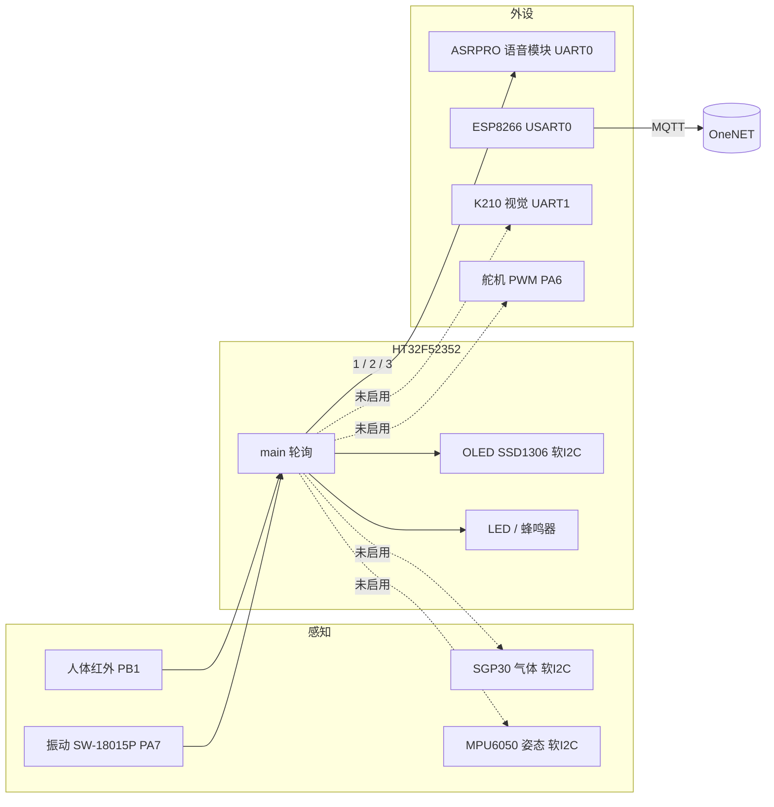

# 智能校车安全监测系统 · Smart School Bus

> 盛群 HT32F52352（Cortex-M0+，48 MHz）的校车安全监测节点：人体遗留检测、座椅振动检测、
> OLED 本地提示、语音模块播报，通过 ESP8266 接 OneNET(MQTT) 的联网框架。




---

## 目录

- [1. 项目简介](#1-项目简介)
- [2. 功能与实现状态](#2-功能与实现状态)
- [3. 硬件与引脚](#3-硬件与引脚)
- [4. 固件设计](#4-固件设计)
- [5. 云端接入](#5-云端接入)
- [6. 仓库结构](#6-仓库结构)
- [7. 编译与烧录](#7-编译与烧录)
- [8. 开源整理说明与已知问题](#8-开源整理说明与已知问题)
- [9. 许可证](#9-许可证)

## 1. 项目简介

校车最常见的安全事故是**儿童被遗忘在车内**。这个项目要做的是：用人体红外判断车内是否还有遗留人员，用振动传感器判断孩子是否还在座位上活动，本地 OLED + 蜂鸣器提示，同时把事件码通过串口送给语音模块播报，并把状态往云平台送。

主控用盛群 HT32F52352（M0+，48 MHz，128 KB Flash / 16 KB RAM），裸机前后台架构，不跑 RTOS。

这个仓库最有价值的不是"做成了多少功能"，而是**一个完整的嵌入式工程骨架**：4 路 UART 外设协同、软 I2C 驱动 SSD1306 带显存、ESP8266 AT 状态机、事件码协议——以及一份诚实的"做到哪了"清单。

## 2. 功能与实现状态

| 功能 | 状态 | 实现 |
| --- | --- | --- |
| 人体遗留检测 | ✅ 已跑通 | 红外模块（PB1，高有效），检出后人离开 5 s 才判定，LED1 闪 + 蜂鸣器 + 语音播报 `"1"` |
| 座椅振动检测 | ✅ 已跑通 | SW-18015P（PA7，低有效），触发后语音播报 `"2"` + LED2 闪 |
| OLED 本地显示 | ✅ 已跑通 | SSD1306 128×64，软 I2C（PB7/PB8），自写字库 + 显存 |
| 语音播报 | ✅ 已跑通 | 向 ASRPRO 模块发单字节事件码（`"1"`/`"2"`/`"3"`） |
| Wi-Fi 联网 | ✅ 已跑通 | ESP8266 AT 指令 7 步初始化，连上 MQTT（Broker 应答 `OK`） |
| 云端数据上报 | ❌ 未完成 | 只建立了 MQTT 连接，**没有发过一个 PUB 报文**；`OneNet_SendData()` 无实现 |
| 指纹考勤（AS608） | ❌ 未启用 | 完整协议驱动写好了（`HARDWARE/AS608/`），但没加入工程、依赖的串口变量不存在 |
| K210 视觉 | ❌ 未启用 | 曾加入工程后又被移除，`K210_proc()` 无调用 |
| 环境质量（SGP30） | ⚠️ 半成品 | 只发了 `Init_iaq`（0x2003），从不读数据，CRC 读出即丢弃 |
| 姿态（MPU6050） | ❌ 未启用 | 驱动可用（带 ACK 重试），未加入工程，无姿态解算 |
| 温湿度（DHT11）/ 舵机 / 按键 | ⚠️ 未接入 | 驱动都在，`main()` 里被注释或只做了初始化 |

## 3. 硬件与引脚

| 项目 | 内容 |
| --- | --- |
| 芯片 | HT32F52352（Cortex-M0+，48 MHz，128 KB Flash / 16 KB RAM，无 FPU） |
| 板级 | Holtek HT32F52352 Starter Kit 兼容 |
| 晶振 | HSE 8 MHz，PLL ×6 → 48 MHz（`delay_us` 与 50 Hz PWM 参数自洽） |
| 调试 | 板载 CMSIS-DAP（Holtek CMSIS-DAP，非 J-Link） |

| 功能 | 引脚 | 说明 |
| --- | --- | --- |
| LED1 / LED2 | PC14 / PC15 | 推挽输出，低电平点亮 |
| 蜂鸣器 | PC1 | 8 mA 驱动 |
| 按键 ×4 | PB2 / PB3 / PB4 / PB5 | 上拉输入，PB2 走 EXTI 通道 2（下降沿 + 硬件去抖） |
| 人体红外 | **PB1** | 输入下拉，高电平 = 有人 |
| 振动开关 | **PA7** | 输入上拉，低电平 = 振动 |
| OLED SSD1306 | **PB7 = SCL / PB8 = SDA** | GPIO 模拟 I2C，从机地址 0x78 |
| SGP30 / MPU6050 | **PA0 = SCL / PA1 = SDA** | 另一路软 I2C |
| ESP8266 | **PA2 = TX / PA3 = RX**（USART0，115200）＋ 复位 **PC9** | AT 指令，逐字节中断接收 |
| 调试串口 | PA4 = TX / PA5 = RX（USART1，115200） | `printf` 重定向 |
| 语音模块 | **PC4 = TX / PC5 = RX**（UART0，115200） | 发事件码 |
| K210 | PC12 = TX / PC13 = RX（UART1，115200） | 未启用 |
| 舵机 PWM | **PA6**（GPTM0 CH2，50 Hz） | 只初始化，未驱动 |

> 原理图/PCB/BOM：**原件目录里没有**，这个仓库只有固件。硬件部分只能从引脚表反推。

## 4. 固件设计

### 4.1 主流程（裸机轮询）

```c
int main(void)
{
    OLED_Init();  OLED_Clear(0);
    USART1_Configuration();   // 日志
    USART0_Configuration();   // ESP8266
    UART0_Init();             // 语音模块
    UART1_Init();             // K210（未启用）
    Led_Init(); GPTM_PWM_init(); Buzzer_init(); Key_Init();
    Infrared_Init(); SW_18015P_Init(); SGP30_Init();

    ESP8266_Init();           // 阻塞式 7 步 AT 初始化，无超时
    delay_ms(500);
    OLED_ShowCHinese_five(...);   // 开机 6 字提示
    delay_ms(2000); OLED_Clear(0);

    while (1) {
        // OneNet_SendData();     // TODO: 上报尚未实现
        delay_ms(1000);
        ESP8266_Clear();
        OLED_ShowPicture(0, 0, 128, 64, BMP1, 1);
        infrared_test();          // 人体遗留
        SW_18015P_test();         // 振动
    }
}
```

- **调度**：0 个 RTOS，`while(1)` 轮询；时基靠 `delay_ms()`（SysTick 轮询 `COUNTFLAG`）；
- **中断**：EXTI2_3（按键）、UART0（语音模块收，配合 BFTM0 10 ms 打帧尾）、USART0（ESP8266 逐字节收）、BFTM0（10 ms 超时）；
- **实际周期**：`infrared_test()` 里有 `delay_ms(5000)`，所以主循环一圈约 6 s，不是注释里写的 1 s。

### 4.2 事件码协议（与语音模块）

| 事件 | 行为 |
| --- | --- |
| 人体遗留（人离开后 5 s 内没再检测到） | LED1 闪 + 蜂鸣器 + 串口发 `'1'` → 语音播报"请勿将儿童单独留在车内" |
| 座椅振动 | `led_run2()` + 串口发 `'2'` → 语音提示坐好 |
| 其他状态 | `'3'` |

协议就是**单字节 ASCII**，语音模块端用 ASRPRO 配置事件码对应播报词，MCU 侧零解析成本。

### 4.3 OLED 驱动（软 I2C + 显存）

`HARDWARE/oled/` 里是完整实现，值得参考的点：

- 手写 I2C 时序（Start/Stop/WriteByte/WaitAck），不依赖硬件 I2C 外设；
- 完整 SSD1306 初始化序列（`AE D5 A8 D3 40 8D 14 20 A1 C8 DA 81 D9 DB A4 A6 AF`）；
- 字库：F6x8、F8X16、16×16 汉字（`zhiwen[][32]`）、128×64 位图（`BMP1[]`）；
- 显存 `OLED_GRAM[144][8]` + `OLED_DrawPoint()` + `OLED_ShowPicture()` 画点/贴图接口。

### 4.4 驱动清单

| 目录 | 模块 | 总线 |
| --- | --- | --- |
| `HARDWARE/infrared` | 人体红外 | GPIO |
| `HARDWARE/SW_18015P` | 振动开关 | GPIO |
| `HARDWARE/oled` | SSD1306 OLED | 软 I2C |
| `HARDWARE/SGP30` + `iic.c` | SGP30 TVOC/eCO₂ | 软 I2C |
| `HARDWARE/mpu6050` | MPU6050 六轴（带 ACK 重试） | 软 I2C |
| `HARDWARE/dht11` | DHT11 单总线 | 单总线 |
| `HARDWARE/time1` + `My_servo` | 舵机（GPTM0 CH2，50 Hz） | PWM |
| `HARDWARE/UART`、`USART` | 4 路串口 + `printf` 重定向 | UART |
| `NET/ESP8266` | ESP8266 AT 状态机 | UART |
| `HARDWARE/onenet` | OneNET MQTT 组包（未完成） | — |

## 5. 云端接入

`NET/ESP8266/esp8266.c` 里的流程（全部阻塞 + 无限重试）：

```
硬复位(PC9 低 250ms → 高 500ms)
 → AT
 → AT+CWMODE=1
 → AT+CWDHCP=1,1
 → AT+CWJAP="<SSID>","<PASSWORD>"        // 等 "GOT IP"
 → AT+MQTTUSERCFG=0,1,"NULL","<PRODUCT>","<TOKEN>",0,0,""
 → AT+MQTTCONN=0,"mqtts.heclouds.com",1883,1
```

- 平台：OneNET（旧版 MQTT 接入，1883 明文端口）；
- 上报 topic 定义了 `$sys/<产品ID>/<设备名>/thing/property/post`，但**没有任何代码往里发数据**；
- 断网处理：**没有**。`ESP8266_Init()` 每步都是 `while (SendCmd(...)) delay_ms(500);`，Wi-Fi 不可用会永久卡在初始化。

> 仓库里的 SSID、密码、产品 ID、设备 token **全部换成了占位符**（`YOUR_WIFI_SSID` / `YOUR_PRODUCT_ID` / `YOUR_SIGN`）。原来的 token 是真实可用的，公开前必须脱敏——这也是这个仓库的一个"坑位提醒"。

## 6. 仓库结构

```
smart-school-bus/
├── README.md
├── LICENSE
├── docs/
│   ├── 02-status.md              # 模块状态、坑、下一步（比 README 更细）
│   └── reference/
│       └── author-readme.txt     # 作者当时的接线记录（3 行，且与代码有出入）
└── firmware/
    ├── HARDWARE/                 # 各外设驱动
    │   ├── infrared/  SW_18015P/  oled/  SGP30/  mpu6050/  dht11/
    │   ├── My_buzzer/  My_key/  My_servo/  LED/  time1/  time/
    │   ├── UART/  USART/  Delay/  adc/  K210/  sys/  onenet/
    │   └── sys.h
    ├── NET/ESP8266/              # ESP8266 AT 驱动
    ├── User/                     # main.c + 中断向量
    ├── Utilities/                # ht32_board.c/h（板级初始化）
    └── Project/Templete.uvprojx  # Keil 工程
```

## 7. 编译与烧录

| 项目 | 值 |
| --- | --- |
| IDE | Keil µVision + ARMCC **V5.06 update 5**（`uAC6=0`，未用 AC6） |
| 器件包 | `Holtek.HT32_DFP.1.0.44` |
| Target | `Target 1`，芯片 HT32F52352，IROM 0x0/0x1FE00，IRAM 0x2000/0x4000 |
| 优化 | `-O3`，One ELF Section，C99，microlib |
| 产物 | `Output/Project.axf`、`Project.hex`（含 `fromelf --bin` 生成的 bin） |
| 体积 | Code 9 720 B / RO 5 412 B / RW 24 B / ZI 1 296 B → **Flash 约 14.8 KB，RAM 1.3 KB** |
| 烧录 | 板载 Holtek CMSIS-DAP（`-U200017E2`），Flash 算法 `HT32F.FLM` |
| 工程路径 | 全部相对路径（`..\`），换机器不用改；但 **路径不能含中文** |

编译前需要补 `Libraries/`（盛群 HT32 SDK：CMSIS、Device、`HT32F5xxxx_Driver`、`HT32_USBD_Library`），仓库里没有随附。

## 8. 开源整理说明与已知问题

### 整理做了什么

1. **编码**：原工程 GBK/UTF-8 混用，全部统一成 UTF-8 + LF；
2. **剔除**：`Libraries/`（盛群 SDK）、`Output/`（443 个构建产物，49 MB）、`Listing/`、`Project/*.uvguix.*`、`*.bak`、467 个带 `(1)` 的重复副本、`Utilities/common` + `HT32_Board`（盛群板级例程，作者零调用）、`HARDWARE/AS608`（第三方指纹例程，未编译）；
3. **修复三处导致工程编译不过的问题**（原始构建日志是 `16 Error(s)`）：
   - `My_servo.c` 里 `Servo_Run2/3/4` **各重复定义两次** → 删除重复块；
   - `infrared.h` 第 1 行注释缺 `/*` → 补上；
   - `main.c` 调用了不存在的 `OneNet_SendData()` → 注释掉并标 `TODO`；
4. **脱敏**：ESP8266 的 Wi-Fi 账号密码、OneNET 产品 ID / token 全部换成占位符。

> 说明：修复后**没有**在本机重新编译验证（环境里没有 Keil/ARMCC），改动是机械的（删重复函数、补注释符、注释掉一个未定义调用），如果编译仍有问题请对照上面三条回退。

### 已知问题（真实存在，未修）

| 问题 | 影响 |
| --- | --- |
| 云端没有上报 | `OneNet_SendData()` / `ESP8266_SendData()` / `onenet.c` 全是注释状态，全工程无 `AT+MQTTPUB` |
| ESP8266 初始化无超时 | Wi-Fi 不可用会永久卡死；主循环也没有链路检测/重连 |
| 引脚冲突 | PA2/PA3 同时被 ESP8266（USART0）和 AS608（HT_USART0）占用；PA3 还是 DHT11 的脚；PA1 是软 I2C SDA 又被 `time1.c` 配成输出 |
| UART1 开了中断但无 ISR | K210 那个 `UART1_IRQHandler` 在未编译的 `K210.c` 里，真收到字节会进默认死循环 |
| OLED 贴图不刷新 | `OLED_ShowPicture()` 只写显存，没有把 `OLED_GRAM` 刷回屏的函数 |
| `led_run2()` 未定义 | `SW_18015P.c` 调用的 `led_run2()` 在 `led.c/h` 里不存在 |
| 注释与实现不符 | `Doc/reardme.txt` 写 DHT11 接 A0、舵机 PC4/5/8/9，与代码（PA3、PA6）不符 |
| 死代码 | `time/time.c` 未加入工程且与 `time1/time1.c` 函数重名（只有 `time.h` 被 `sys.h` include）、`adc/adc.c` 全文注释、`K210.c`/`MPU6050.c` 未加入工程 |

## 9. 许可证

代码以 MIT 发布（见 [LICENSE](LICENSE)）。`firmware/` 里的 `ht32f5xxxx_*` 系列头文件、`Utilities/ht32_board.*` 来自盛群（Holtek）SDK，版权归盛群；`Project/Templete.uvprojx` 为工程配置。
